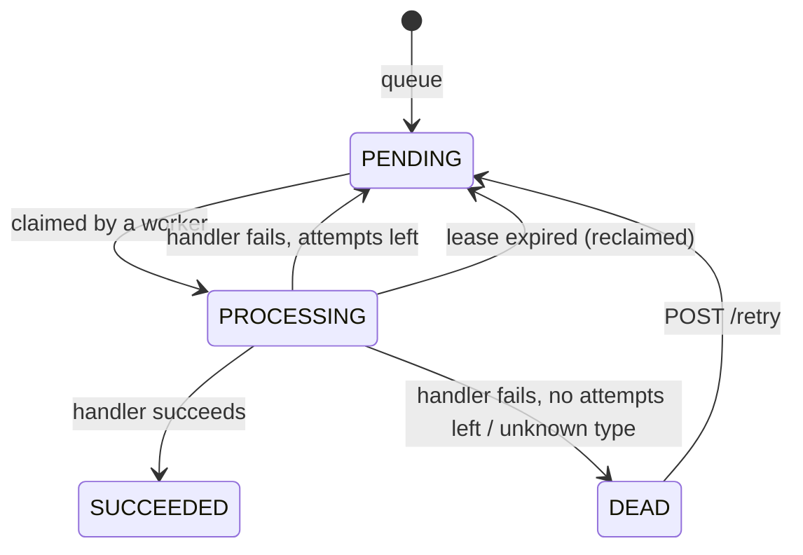
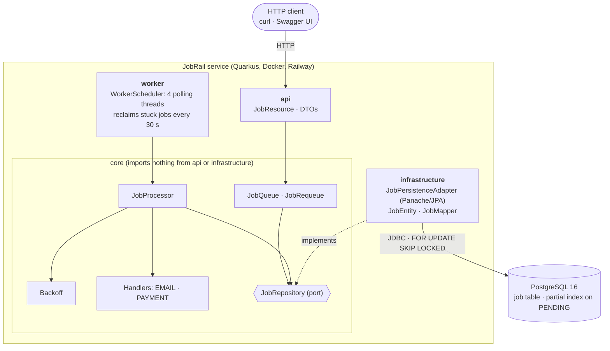

# JobRail

A Postgres-backed job queue service: concurrent workers, exponential-backoff retries, a dead-letter queue,
and crash recovery through leases. It is built with Quarkus, containerised, and deployed on Railway.

**Live:** <https://jobrail.up.railway.app> · [Swagger UI](https://jobrail.up.railway.app/q/swagger-ui/) ·
[Health](https://jobrail.up.railway.app/q/health/ready)

The job handlers (`EMAIL`, `PAYMENT`) are **simulations** that fail about half of the time on purpose. The point of the
project is the queue mechanics around them: claiming, retrying, dead-lettering, and recovering stuck jobs.

## Try it

```bash
# queue a job; the response is the job id
curl -X POST https://jobrail.up.railway.app/api/jobs \
  -H "Content-Type: application/json" \
  -d '{"type":"EMAIL","payload":"{\"to\":\"someone@example.com\"}","maxAttempts":3}'

# follow it
curl https://jobrail.up.railway.app/api/jobs/<id>

# counts per status
curl https://jobrail.up.railway.app/api/jobs/stats
```

`payload` is a string (JSON-in-a-string works, so quotes must be escaped). `maxAttempts` is the total number of tries
before a job is dead-lettered.

## API

| Method | Path | Purpose |
|---|---|---|
| `POST` | `/api/jobs` | Queue a job (`type`, `payload`, `maxAttempts`). Returns the job id. |
| `GET` | `/api/jobs/{id}` | Get one job. `404` if unknown. |
| `GET` | `/api/jobs?status=` | List jobs, optionally by status. `400` on an unknown status. |
| `POST` | `/api/jobs/{id}/retry` | Requeue a `DEAD` job (resets its attempts). `404` if it isn't dead. |
| `GET` | `/api/jobs/stats` | Job count per status, with zero-filled statuses. |
| `GET` | `/q/health/live`, `/q/health/ready` | Liveness and readiness (readiness includes the database check). |
| `GET` | `/q/openapi`, `/q/swagger-ui/` | OpenAPI document and Swagger UI. |

## How it works

### Job lifecycle



### Architecture



The code is split into four packages:

- **`core`**: the queue's rules. `JobQueue`, `JobProcessor`, `Backoff`, the handlers and the `JobRepository` interface.
  It imports nothing from `api` or `infrastructure`.
- **`infrastructure`**: the Panache/JPA implementation of `JobRepository`, the entity, and the MapStruct mapper.
  It's the only place that knows about SQL, locking and transactions.
- **`api`**: the REST resource and its DTOs. It calls `core`, and `core`'s exceptions are turned into HTTP errors by the
  mapper described in the project structure below.
- **`worker`**: the runtime glue. A fixed thread pool that polls `JobProcessor`, and a scheduled lease reclaimer.

### Project structure

```
JobRail/
├── .github/workflows/ci.yml       CI: test job (Postgres + mvn verify), then docker build
├── Dockerfile                     multi-stage build, non-root runtime image
├── docker-compose.yml             app + Postgres; postgres-test behind the "test" profile
├── pom.xml
├── PLAN.md                        the build plan this project followed
└── src/
    ├── main/
    │   ├── java/org/jobrail/
    │   │   ├── api/
    │   │   │   ├── JobResource.java          /api/jobs endpoints
    │   │   │   └── dto/                      QueueJobDTO, JobsStatsResponseDTO, GroupedStat
    │   │   ├── core/
    │   │   │   ├── Job.java                  immutable job record
    │   │   │   ├── JobQueue.java             queue a job (validation)
    │   │   │   ├── JobRequeue.java           replay a DEAD job
    │   │   │   ├── JobProcessor.java         claim, run, retry, dead-letter, reclaim
    │   │   │   ├── Backoff.java              pure retry-delay function
    │   │   │   ├── JobRepository.java        the port the adapter implements
    │   │   │   ├── JobHandler.java           handler interface
    │   │   │   ├── JobHandlerRegistry.java   handler lookup by type
    │   │   │   ├── JobStatus.java            status contract
    │   │   │   ├── JobStatusRegistry.java    all statuses, lookup by name
    │   │   │   ├── jobstatuses/              Pending, Processing, Succeeded, Dead
    │   │   │   ├── jobhandlers/              Email, Payment (simulated)
    │   │   │   ├── queries/                  GetJob, ListJobs, GetJobsStats
    │   │   │   └── exceptions/               domain exceptions, ErrorResponse, ApiExceptionMappers
    │   │   ├── infrastructure/
    │   │   │   ├── JobPersistenceAdapter.java  JobRepository on Panache/JPA (claim, guarded updates)
    │   │   │   ├── JobEntity.java
    │   │   │   ├── JobMapper.java              MapStruct
    │   │   │   └── JobStatusConverter.java     status <-> text column
    │   │   └── worker/
    │   │       └── WorkerScheduler.java        polling thread pool + lease reclaimer
    │   └── resources/
    │       ├── application.properties
    │       └── database/migrations/V1__create_job_table.sql
    └── test/java/org/jobrail/
        ├── core/                  JobProcessor, JobQueue, queries, status registry, exception mappers
        ├── api/                   REST endpoints (RestAssured), stats DTO, health
        ├── infrastructure/        adapter SQL, concurrent claim, mapper, status converter
        └── worker/                scheduler unit tests, end-to-end worker pool test
```

One placement to be aware of: `ApiExceptionMappers` uses JAX-RS (`@ServerExceptionMapper`) but sits in
`core/exceptions`. It's HTTP adapter code, so strictly it belongs in `api`. `core` still imports nothing from
`org.jobrail.api` or `org.jobrail.infrastructure`, and it is the only class in `core` that touches a web framework.

## Design decisions

**Workers never wait for each other.** Each worker takes one job at a time, and if another worker is already holding a
job, it simply skips to the next one instead of waiting in line. So many workers can pull different jobs at once. A test
runs several workers against the same queue and checks that no job is ever taken twice.

**Failed jobs end up in a "dead" state, not a separate table.** When a job runs out of tries, it's marked `DEAD` and stays
in the same table with all its details. Looking at it or running it again (`/retry`) is just a status change. The
trade-off is that dead jobs share a table with live ones, which is fine at this size.

**Retries wait a bit longer each time.** A failed job goes back in the queue with a "not before" time: 2 seconds after the
first failure, then 4, 8 and so on, up to 5 minutes. Workers only pick up jobs whose time has come, so the waiting
needs no timers or extra machinery.

**Jobs don't get stuck if a worker crashes.** A job being worked on has a 60-second lease. If the worker dies, a
background check notices the lease ran out and either puts the job back in the queue or marks it dead. Those updates only
apply if nobody else has touched the job in the meantime, so two workers can't overwrite each other.

**A job might run more than once.** If a worker is slow and its job gets handed to another one, both can end up running
it. The queue promises a job is never lost, not that it runs exactly once, so handlers should be safe to repeat.

**The queue's rules don't depend on the database.** The core code only talks to a small interface, and the database code
implements it. That keeps the rules easy to test: the retry and dead-letter logic is tested without a database, and the
database parts are tested against a real Postgres.

## Run it locally

Requirements: JDK 25, Maven and Docker.

```bash
# 1. config: create .env in the project root
JOBRAIL_DATASOURCE_USERNAME=jobrail
JOBRAIL_DATASOURCE_PASSWORD=<choose one>
JOBRAIL_DATASOURCE_DB=jobrail-dev
JOBRAIL_DATABASE=postgresql
JOBRAIL_TEST_DATASOURCE_PASSWORD=<same value as above>

# 2. the whole stack: app + Postgres
docker compose up -d --build
```

The app is then on <http://localhost:8080> (Swagger UI at `/q/swagger-ui/`).

For development with live reload, start only the database and run Quarkus yourself:

```bash
docker compose up -d postgres
mvn quarkus:dev
```

### Tests

The tests run against a real Postgres on port 5433 (an explicit URL turns Quarkus Dev Services off):

```bash
docker compose up -d postgres-test
mvn test
```

The suite covers the processor's decisions with mocks, the SQL and locking against Postgres, a concurrent-claim test,
the REST layer, and the worker pool.

## Configuration

| Variable | Default | Notes |
|---|---|---|
| `PORT` | `8080` | HTTP port. Railway injects it. |
| `JOBRAIL_DATASOURCE_URL` | `jdbc:postgresql://localhost:5432/jobrail-dev` | Must be a **JDBC** URL, not `postgres://`. |
| `JOBRAIL_DATASOURCE_USERNAME` | `jobrail` | |
| `JOBRAIL_DATASOURCE_PASSWORD` | none, required | The app refuses to start without it. Local: put it in `.env`. |
| `JOBRAIL_TEST_DATASOURCE_URL` | `jdbc:postgresql://localhost:5433/jobrail-test` | Tests only. |
| `JOBRAIL_TEST_DATASOURCE_PASSWORD` | none, required | Tests only. |
| `jobrail.workers.count` | `4` | Worker threads. |
| `jobrail.workers.poll-interval` | `1s` | Sleep when the queue is empty. |
| `jobrail.workers.reclaim-interval` | `30s` | How often stuck jobs are looked for. |

## Deployment

CI (`.github/workflows/ci.yml`) runs on every pull request and on pushes to `main`. It starts a Postgres with a random
throwaway password, runs `mvn verify`, and then builds the Docker image. Deployment is Railway's GitHub integration; with
"Wait for CI" enabled on the service, `main` ships only after the pipeline is green.

On Railway the app service needs three variables, built from the Postgres service's references:

```
JOBRAIL_DATASOURCE_URL=jdbc:postgresql://${{Postgres.PGHOST}}:${{Postgres.PGPORT}}/${{Postgres.PGDATABASE}}
JOBRAIL_DATASOURCE_USERNAME=${{Postgres.PGUSER}}
JOBRAIL_DATASOURCE_PASSWORD=${{Postgres.PGPASSWORD}}
```

`Postgres` must match the Postgres service's name in the project. Set the service healthcheck path to
`/q/health/ready`.

## Stack

Java 25 · Quarkus 3.39 · Hibernate ORM with Panache · PostgreSQL 16 · Flyway · MapStruct · Lombok · JUnit 5, Mockito and
RestAssured · Docker (multi-stage, non-root) · GitHub Actions · Railway.
